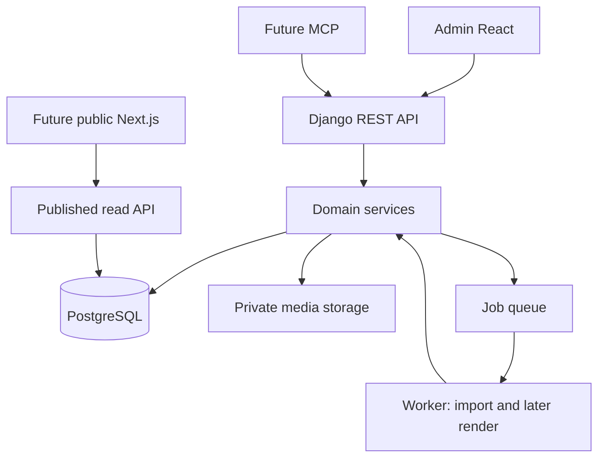

# Architecture

## Decision record
ADR-001: Django + DRF modular monolith, PostgreSQL authority. React/TypeScript/Tailwind admin served behind same origin as API; Next.js later. Celery/Redis for asynchronous work (introduce with imports/rendering as needed). S3-compatible private object storage. Docker Compose local/staging; production topology qualified separately. Nginx TLS ingress. Existing Jinja2/Playwright renderer and MCP isolated as adapters. CI provider selection awaits repository location; no remote repository supplied.

## Boundaries
accounts, catalog (categories/areas/venues/promoters), events, media, editorial/issues, imports, reports, audit, publishing. Service methods implement business rules; views validate inputs and enforce permissions; ORM transactions and constraints protect writes. Admin UI never writes database directly. Background jobs use explicit service identities and idempotency keys. Public read layer consumes approved snapshots/explicit allowlisted DTOs only, not admin serializers. Avoid unneeded microservices.

## Authentication
Same-origin secure HttpOnly session cookies; CSRF tokens on unsafe requests; no browser localStorage bearer tokens. Default deny; action and object scope checks. Staff invitations or admin-controlled creation, no public registration. Rate-limit authentication, require MFA for privileged production users (implementation selected in phase 01), revoke sessions on deactivation. Do not log passwords, tokens or contact details.

## Environment and operations
Development, staging, production separated by credentials, storage and database. Environment configuration or secret store; fail startup if production configuration is unsafe. Readiness and liveness checks, structured logs, alerts for failures and backups. Pin dependency versions and container image digests after compatibility CI; do not infer latest versions from archive. Renderer worker must not access arbitrary local paths or network URLs supplied by editors; use verified asset identifiers, isolated filesystem and network restrictions.

## Preservation
Original archive SHA-256 recorded in evidence. Keep archive in private reference custody; never ship its bundled font files in this specification package. Source behavior captured in baseline, then qualify intentional differences before replacement. Do not modify original workbook.
