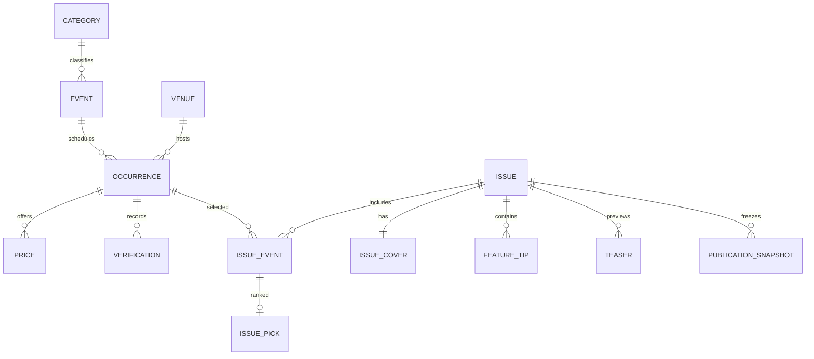

# Logical database design (PostgreSQL)
All entity IDs UUID except optional display sequence. Timestamps timezone-aware; UGX amounts integer, nonnegative; use explicit nullable values. Tables below logical, Django migrations in Phase 01 onward. All mutable business rows include created_at, updated_at, created_by where applicable and integer version. Foreign keys PROTECT historical references; archive instead of destructive deletes.

| Entity | Key fields and relationships |
|---|---|
| user / group / permission | Django custom user from first migration; activation, staff scope, Django permissions |
| category | unique stable code, label, hex colour, order, active |
| country / city / area | unique normalized names within parent, active; Uganda/Kampala defaults, preserve other cities |
| venue | area FK, name, address, optional lat/lon pair, contact, active; normalized name+area duplicate candidate |
| promoter | name, private contact, public contact opt-in, active |
| event | title, category FK, promoter FK nullable, description, archived_at |
| occurrence | event FK, venue FK, editorial_date, starts_at, ends_at nullable, timezone, verification_status, cancellation status, source, notes; nullable required fields only for draft/incomplete import |
| price | occurrence FK, type FREE/PAID/CONDITIONAL_FREE/UNKNOWN, amount_ugx nullable, tier, note, ticket_url |
| verification | occurrence FK, version, actor FK, decision, evidence, reason, timestamp; append-only |
| media_asset | opaque object key unique, mime, bytes, sha256, scan_state, rights, alt text, owner, visibility |
| occurrence_media | occurrence FK, asset FK, kind, order |
| issue | unique issue number, week_start, grid_day, workflow_status, mock flag, revision; week_end derived |
| issue_event | issue FK, occurrence FK, grid_span 1–5 nullable, grid selection, paid feature flag, feature fee nullable; unique issue+occurrence |
| issue_pick | issue_event FK, issue FK, rank 1–7, why_go, curator_playing, disclosure; unique issue+rank and issue_event; enforce same issue |
| issue_cover | issue FK unique, accent, name, subtitle, photo FK |
| cover_line | cover FK, position 1–3, title, body; unique cover+position |
| issue_editorial | issue FK unique, picks_title, byline, intro, headshot FK, feature_title/subtitle/kicker, sponsor FK nullable, website label, whatsapp label, submission contact |
| feature_tip | issue FK, position 1–5, title, body; unique issue+position |
| teaser | issue FK, position 1–4, linked occurrence nullable, date, name, place, category FK; unique issue+position |
| sponsor | name, logo FK, private contact, active |
| import_batch / import_row | source digest, schema version, actor, state, row/cell provenance, errors, mapped IDs; unique commit idempotency key |
| audit_event | actor, action, object type/id, sanitized diff, timestamp, correlation id, reason; append-only |
| publication_snapshot / build / file | future: issue revision, immutable allowlisted snapshot, schema version, manifest digest, output key, status; unique issue+revision |

## Invariants
Submitted/verified occurrences require title/category/date/start/venue/area; verification requires authenticated verifier and evidence/reason. Editing material facts invalidates verification atomically and invalidates pending issue approval. Cancellation is orthogonal to verification. starts_at is actual local instant; editorial_date is explicit, normally date of start, or previous date for after-midnight night listings. Require explicit end date when overnight; ends_at > starts_at. Issue seven-day period and grid day inside range. Prevent duplicate issue ranks transactionally; qualifying issue_event must be verified, noncancelled, in editorial date range. DB checks for ranks, money, ranges, allowed enum values; cross-table rules enforced under locks in service layer, with tests. Lock issue before rank changes; optimistic version on edit. No silent timestamp or price correction.

